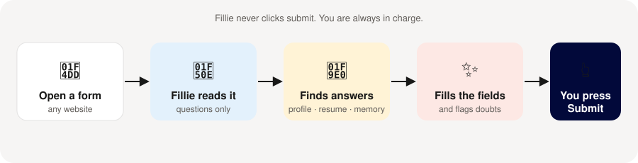
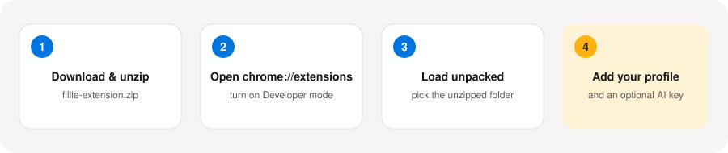
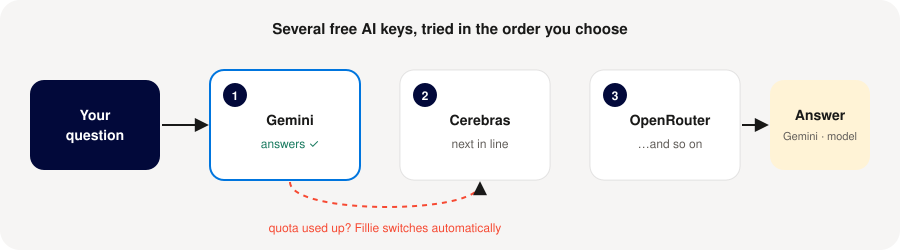

<div align="center">

# Fillie

**Fills online forms for you. You press submit.**

A free, open-source Chrome extension that fills job applications and forms from your profile and resume.

[Website](https://YOUR-SITE.vercel.app) · [Download](../../releases) · [Support](https://YOUR-SITE.vercel.app/#donate)

</div>



## Why Fillie

- **You stay in charge.** It never clicks Submit.
- **Private.** Your profile stays on your device. API keys never leave it.
- **Works offline.** AI is optional.
- **Learns.** It remembers answers you approve.
- **Tracks your applications.** Status, interview dates, offers (LPA), notes and a rating for each company.
- **Safe backup.** Sign in to back up your data and applications in the cloud.

## Install

1. Download `fillie-extension.zip` from [Releases](../../releases) and unzip it.
2. Open `chrome://extensions` and turn on **Developer mode**.
3. Click **Load unpacked** and pick the unzipped folder.
4. Open Fillie and add your profile.



Or build it yourself:

```bash
npm install
npm run build   # then load the dist/ folder
```

## Use it

Open a form and click Fillie (or press **Alt + Shift + F**). Check the answers, then submit.

## Free AI (optional)

In **Settings → AI platforms**, paste a free key from [Gemini](https://aistudio.google.com/apikey), [Cerebras](https://cloud.cerebras.ai), [OpenRouter](https://openrouter.ai/keys) or others. Put them in your preferred order; if one runs out of quota, Fillie moves to the next.



## Contribute

```bash
npm run watch       # rebuild on save
npm run test:unit
```

See [CONTRIBUTING.md](CONTRIBUTING.md). Licensed under [MIT](LICENSE).
